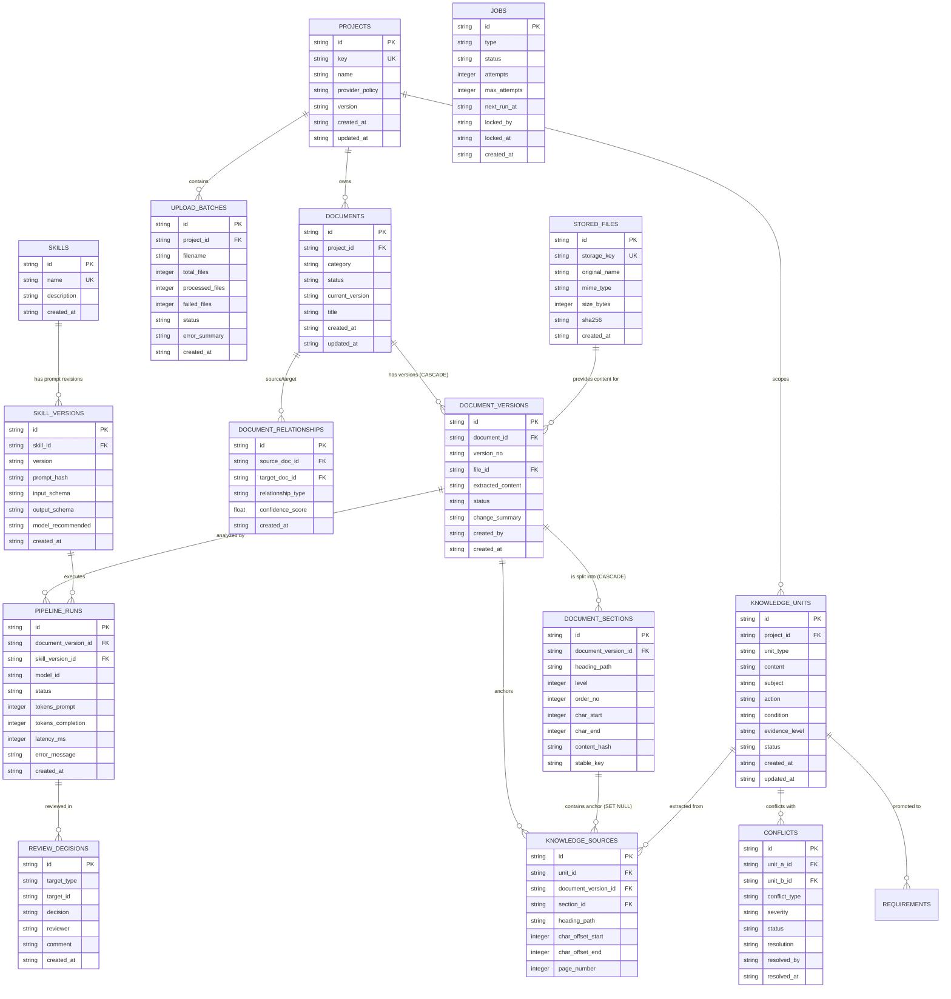

# Document Data Model & Knowledge Layer Specification

**Version:** 1.0.0-MVP  
**Status:** Approved by Tech Lead & BA  
**Ref Backlog:** `docs/BACKLOG-AI-DOCUMENT-PIPELINE.md` (Task E1-T2)  
**Storage Architecture:** SQLite WAL Mode + Structured FileStore (`server/data/files/`)

---

## 1. Mục tiêu & Nguyên tắc Thiết kế (Design Principles)

1. **Source of Truth là File Gốc (Original File as Source of Truth)**:
   - Nội dung tài liệu không chỉ lưu dạng JSON blob mà lưu tệp gốc nguyên vẹn byte-for-byte trong `stored_files` qua module `FileStore`.
   - Mã băm SHA-256 được tính toán trực tiếp trên toàn bộ byte của file gốc để chống giả mạo và bảo đảm tính toàn vẹn kiểm toán.
2. **Phiên bản Hóa Quan hệ (Relational Document Versioning)**:
   - Mỗi tài liệu (`documents`) sở hữu nhiều phiên bản (`document_versions`).
   - Mỗi phiên bản liên kết chính xác với một file gốc (`stored_files`) và chứa văn bản trích xuất có cấu trúc (`extracted_content`).
3. **Truy vết Toàn vẹn cho AI (Full AI Traceability)**:
   - Mọi kết quả phân tích AI đều truy ngược được về đúng `document_version_id`, `skill_version_id`, `model_id` và lưu vết token, latency trong `pipeline_runs`.
4. **Kiến trúc Tri thức Nguyên tử (Atomic Knowledge Layer)**:
   - Tri thức phân rã thành các đơn vị nguyên tử (`knowledge_units`) kèm vị trí neo chính xác (`knowledge_sources`: heading path, char offset, page).
   - Phân định rõ ràng giữa `evidence_level` (Explicit / Inferred / Assumed...) và `status` xét duyệt (Draft / In_Review / Approved / Superseded).
5. **Quyết định con người là tối cao (Human-in-the-Loop Governance)**:
   - Điểm số rủi ro hay AI chỉ dùng để xếp hàng đợi duyệt. Mọi trạng thái `Approved` đều ghi vết qua `review_decisions`.

---

## 2. Biểu đồ Quan hệ Thực thể (Mermaid ERD)



---

## 3. Danh mục Chi tiết Thực thể & Trường dữ liệu

### 3.1. Nhóm Quản lý Tệp & Phiên bản Tài liệu (Storage & Document Lifecycle)

#### 1. Bảng `stored_files`
- **Mục đích**: Quản lý các file gốc được lưu trữ trên đĩa (`server/data/files/`).
- **Owner**: Module Storage / FileStore.
- **Cấu trúc trường**:
  | Tên cột | Kiểu | Ràng buộc | Mô tả |
  |---|---|---|---|
  | `id` | `TEXT` | `PRIMARY KEY` | Mã định danh dạng UUID hoặc `FILE-<hash10>` |
  | `storage_key` | `TEXT` | `UNIQUE NOT NULL` | Đường dẫn tương đối trong FileStore (vd: `2026/11/PRJ-01/abc.md`) |
  | `original_name` | `TEXT` | `NOT NULL` | Tên tệp gốc do người dùng tải lên |
  | `mime_type` | `TEXT` | `NOT NULL` | MIME type được phát hiện (vd: `text/markdown`, `application/pdf`) |
  | `size_bytes` | `INTEGER`| `NOT NULL` | Kích thước byte thực tế |
  | `sha256` | `TEXT` | `NOT NULL` | Mã băm SHA-256 tính trực tiếp từ toàn bộ nội dung file gốc |
  | `created_at` | `TEXT` | `NOT NULL` | Thời điểm tải lên |

#### 2. Bảng `document_versions`
- **Mục đích**: Quản lý từng phiên bản độc lập của một tài liệu.
- **Owner**: Module Documents.
- **Cascade Delete**: Khi xóa `documents`, toàn bộ phiên bản thuộc tài liệu tự động bị xóa (`ON DELETE CASCADE`).
- **Cấu trúc trường**:
  | Tên cột | Kiểu | Ràng buộc | Mô tả |
  |---|---|---|---|
  | `id` | `TEXT` | `PRIMARY KEY` | Dạng `DOC-01-V1.0` |
  | `document_id` | `TEXT` | `NOT NULL, FK -> documents(id)` | Khóa ngoại trỏ đến tài liệu cha |
  | `version_no` | `TEXT` | `NOT NULL` | Số hiệu phiên bản (vd: `v1.0`, `v1.1`, `v2.0`) |
  | `file_id` | `TEXT` | `FK -> stored_files(id)` | Trỏ đến file vật lý nguồn |
  | `extracted_content` | `TEXT` | `NULLABLE` | Nội dung văn bản Markdown hoặc text trích xuất từ file |
  | `status` | `TEXT` | `NOT NULL` | `Draft`, `In Review`, `Approved`, `Rejected`, `Superseded` |
  | `change_summary` | `TEXT` | `NULLABLE` | Tóm tắt thay đổi so với bản trước |
  | `created_by` | `TEXT` | `NOT NULL` | Tác giả tải lên / chỉnh sửa |
  | `created_at` | `TEXT` | `NOT NULL` | Thời điểm tạo |

**Nguồn nội dung duy nhất (E11-T1).** Văn bản của tài liệu chỉ nằm ở `document_versions.extracted_content`. Bản ghi `documents.data` không còn giữ bản sao `contentMarkdown`, và phản hồi của `GET /documents`, `GET /documents/:id`, `POST /documents`, `POST /documents/upload` không còn trường này.

- **Đọc nội dung:** `GET /api/v1/documents/:id/content[?version=<versionNo>]` trả `{ documentId, versionId, versionNo, content }`. Không truyền `version` thì trả phiên bản hiện hành (`currentVersion`). Truyền `version` không tồn tại thì trả 404. Route yêu cầu đăng nhập và quyền truy cập project của tài liệu.
- **Ghi nội dung:** `POST /documents` và `POST /documents/:id/versions` vẫn nhận `contentMarkdown` làm tên trường trong request để tương thích; giá trị chỉ được lưu vào phiên bản và file.
- **Dữ liệu cũ:** migration `015_move_legacy_content_to_versions` chuyển bản sao cũ sang phiên bản và chỉ gỡ bản sao khi có phiên bản giữ đúng chuỗi đó. Nội dung cũ không khớp phiên bản nào được giữ trong `documents.data` dưới khóa `legacyContentMarkdown` để người xem lại; không code nào đọc khóa này. Giá trị `contentMarkdown` không phải chuỗi được giữ nguyên.
- **Quay lui:** migration 015 không có bước `down`. Quay lui code về trước E11-T1 đòi hỏi khôi phục bản sao lưu cơ sở dữ liệu chụp trước khi deploy; dữ liệu ghi sau thời điểm đó sẽ mất. Vì vậy phải sao lưu trước khi deploy.

#### 2b. Bảng `document_sections` (E11-T3)
- **Mục đích**: Chia văn bản của một phiên bản thành các section để so sánh giữa các phiên bản và để các task sau (địa chỉ section, tìm kiếm, kiểm tra trùng) có đơn vị nhỏ hơn cả tài liệu.
- **Owner**: Module Documents. Code: `server/src/modules/documents/documentSections.ts` (hàm thuần `splitIntoSections`, `mapSections`, `findSectionForAnchor`) và `server/src/database/documentSectionStore.ts` (đọc/ghi bảng). Migration: `016_document_sections`.
- **Dữ liệu dẫn xuất**: section luôn được tính lại từ `document_versions.extracted_content` đang lưu. Không code nào của phần này ghi vào `extracted_content`. Không có LLM, không gọi mạng.
- **Cascade Delete**: xóa `document_versions` (trực tiếp, hoặc qua xóa `documents`, hoặc qua xóa project) thì section bị xóa theo (`ON DELETE CASCADE`).
- **Cấu trúc trường**:
  | Tên cột | Kiểu | Ràng buộc | Mô tả |
  |---|---|---|---|
  | `id` | `TEXT` | `PRIMARY KEY` | `<document_version_id>#<stable_key>`. Xác định được từ dữ liệu nên ghi lại section không đổi thì id không đổi |
  | `document_version_id` | `TEXT` | `NOT NULL, FK -> document_versions(id) ON DELETE CASCADE` | Phiên bản chứa section |
  | `heading_path` | `TEXT` | `NOT NULL` | Mảng JSON các tiêu đề từ cấp cao nhất xuống tiêu đề của section (vd: `["Đặc tả yêu cầu","Mục tiêu"]`). `[]` với section cấp 0 |
  | `level` | `INTEGER` | `NOT NULL` | 1 đến 6 theo số dấu `#`. 0 cho phần trước tiêu đề đầu tiên và cho section chia theo đoạn |
  | `order_no` | `INTEGER` | `NOT NULL, UNIQUE (document_version_id, order_no)` | Thứ tự trong văn bản, từ 0 |
  | `char_start` | `INTEGER` | `NOT NULL, >= 0` | Vị trí bắt đầu trong `extracted_content` |
  | `char_end` | `INTEGER` | `NOT NULL, > char_start` | Vị trí kết thúc (không bao gồm) |
  | `content_hash` | `TEXT` | `NOT NULL` | `sha256:<hex>` của nội dung section sau khi đổi xuống dòng về `\n` và bỏ khoảng trắng ở cuối |
  | `stable_key` | `TEXT` | `NOT NULL, UNIQUE (document_version_id, stable_key)` | Định danh section giữa các phiên bản. Có index riêng trên `stable_key` |

**Offset.** `char_start`, `char_end` là vị trí trong chuỗi JavaScript của `extracted_content` đúng như đang lưu (đơn vị UTF-16, tức đơn vị của `String.prototype.slice`), nên `content.slice(char_start, char_end)` chính là section. Ký tự ngoài BMP (ví dụ emoji) chiếm 2 đơn vị; hàm `length()`/`substr()` của SQLite đếm theo code point nên không dùng trực tiếp được với các offset này khi văn bản có ký tự như vậy. Các section của một phiên bản được sắp thứ tự, không chồng nhau và phủ kín toàn bộ văn bản.

**Quy tắc chia section.**
- Mỗi dòng tiêu đề kiểu ATX (`#` đến `######`, sau dấu `#` là khoảng trắng hoặc hết dòng, thụt tối đa 3 dấu cách) nằm ngoài khối code có rào (` ``` ` hoặc `~~~`) mở một section. Section kéo dài đến dòng tiêu đề kế tiếp ở bất kỳ cấp nào. Section phẳng: section của tiêu đề cha không chứa các tiêu đề con.
- Phần văn bản trước tiêu đề đầu tiên là một section cấp 0, `heading_path` rỗng, `stable_key = preamble`. Nếu phần đó chỉ có khoảng trắng thì không thành section riêng mà thuộc section của tiêu đề đầu tiên.
- Văn bản không có tiêu đề nào được chia theo đoạn (các khối cách nhau bằng dòng trống; khối code có rào không bị cắt). Mỗi section đoạn gồm cả các dòng trống theo sau nó.
- Văn bản rỗng hoặc `NULL` thì không có section nào (không tạo section giữ chỗ).
- **Không nhận diện**: tiêu đề kiểu Setext (dòng gạch dưới bằng `===` hoặc `---`), tiêu đề HTML, dòng in đậm dùng làm tiêu đề. `\n`, `\r\n` và `\r` đứng lẻ đều được coi là xuống dòng, cùng quy tắc với `content_hash`.
- **Quy tắc bổ sung sau review độc lập PR #10** (khuyến nghị đã áp dụng, Tech Lead xác nhận trước khi gộp):
  - BOM UTF-8 ở đầu văn bản không thuộc nội dung dòng đầu: tiêu đề ở dòng đầu vẫn được nhận. Văn bản lưu không bị sửa và offset không đổi; ký tự BOM nằm trong mục đầu tiên và bị bỏ qua khi tính `content_hash`.
  - Dòng nằm trong chú thích HTML nhiều dòng (`<!--` tới `-->`) hoặc trong `<pre>` tới `</pre>` không phải tiêu đề. Khối chỉ được mở khi dấu mở đứng đầu dòng (sau tối đa 3 dấu cách), và sau `<pre` phải là dấu cách, tab, `>` hoặc hết dòng, giống điều kiện mở khối HTML của CommonMark. `<pre>` hay `<!--` nằm giữa câu, trong mã nội dòng, trong tiêu đề, hoặc chuỗi như `<prefix>` là văn bản thường. Chú thích mở ở đầu dòng mà không bao giờ đóng thì kéo tới hết tài liệu (như CommonMark).
  - **Giới hạn chi phí.** `heading_path` chỉ giữ 200 ký tự đầu của mỗi tiêu đề (thêm `…` khi bị cắt); `stable_key` vẫn tính trên toàn bộ tiêu đề. Mỗi phiên bản có tối đa 10.000 mục; khi chạm giới hạn, phần còn lại của văn bản thuộc về mục cuối. Nhờ vậy thời gian và dung lượng tăng theo độ dài văn bản, không theo tích của độ dài tiêu đề với số mục con. Dung lượng `heading_path` của một phiên bản vì thế tối đa khoảng 13 MB (10.000 mục, sâu 6 cấp, tiêu đề đều dài hơn 200 ký tự).
  - `content_hash` chuẩn hóa Unicode về NFC, giống `stable_key`.
  - Phiên bản có file gốc là PDF chỉ được chia theo đoạn, không theo dòng `#`. Lý do: bộ đọc PDF hiện tại đoán tiêu đề (dòng danh sách đánh số và dòng IN HOA thành dòng `#`). Khi bộ đọc được sửa và đo trên PDF thật, quy tắc này cần xem lại.
- **Nhận nhầm đã biết, chưa xử lý**:
  - Đoạn thân bài DOCX bắt đầu bằng `# ` (ví dụ "# of users: 5") bị coi là tiêu đề cấp 1 và làm đổi khóa của các mục phía sau. Bộ đọc DOCX trả danh sách tiêu đề đúng nhưng không thoát ký tự `#` trong thân bài.
  - PDF: dòng đánh dấu trang (`-- 1 of 3 --`) là một đoạn riêng, nên thêm hoặc bớt trang làm các đoạn đánh dấu trang hiện là "bớt" và "thêm". Các đoạn nội dung không bị ảnh hưởng.

**Quy tắc `stable_key`.**
- *Section có tiêu đề*: `h-` + 16 ký tự hex đầu của SHA-256 trên chuỗi ghép (bằng `/`) các mã SHA-256 của từng tiêu đề đã chuẩn hóa trong đường dẫn. Mỗi tiêu đề được băm một lần, trên toàn bộ tiêu đề chứ không phải phần hiển thị đã cắt trong `heading_path`. Chuẩn hóa từng tiêu đề: Unicode NFC, gộp khoảng trắng, bỏ khoảng trắng hai đầu, chuyển chữ thường. Dấu tiếng Việt được giữ: "Mục tiêu" và "Mục tiếu" cho hai key khác nhau; "Mục tiêu" viết ở dạng NFC hay NFD, hoa hay thường, cho cùng một key. Key không phụ thuộc vị trí hay nội dung, nên đổi thứ tự section hoặc sửa nội dung thì key giữ nguyên.
- *Trùng `heading_path` trong một phiên bản*: lần xuất hiện thứ 2, 3... theo thứ tự trong văn bản nhận hậu tố `-2`, `-3`... **Giới hạn**: nếu thêm, xóa hoặc đổi chỗ các section trùng tiêu đề thì số thứ tự dịch chuyển, và key có thể trỏ sang section khác (kết quả so sánh sẽ báo "nội dung thay đổi" thay vì "đổi chỗ").
- *Văn bản không có tiêu đề*: `p-` + 16 ký tự hex đầu của SHA-256 trên nội dung đoạn đã chuẩn hóa như trên (đoạn giống hệt nhau cũng nhận hậu tố `-2`, `-3`...). Giữ ổn định khi đổi thứ tự đoạn, chèn hoặc xóa đoạn khác, hoặc chỉ đổi khoảng trắng/hoa thường trong đoạn. **Không** giữ ổn định khi sửa chữ trong đoạn: đoạn đã sửa xuất hiện như một đoạn bị xóa cộng một đoạn mới, không bao giờ là "nội dung thay đổi".
- **Giới hạn khi đổi tên tiêu đề**: đổi tên một tiêu đề thì key cũ biến mất và key mới xuất hiện (không tự nối hai key). Đổi tên một tiêu đề cha, hoặc chuyển một section sang dưới tiêu đề cha khác, thì các section bên dưới cũng đổi key, vì key tính trên cả đường dẫn. Thêm văn bản trước tiêu đề đầu tiên vào một tài liệu trước đó không có sẽ tạo thêm section `preamble`.
- Thay đổi quy tắc chia section hoặc quy tắc key trong code sẽ làm bước đồng bộ lúc khởi động ghi lại section của mọi phiên bản; key có thể đổi hàng loạt. Cần cân nhắc trước khi sửa `documentSections.ts`.

**So sánh hai phiên bản.** `dbRepository.documentSections.mapVersions(oldVersionId, newVersionId)` ghép section theo `stable_key` và trả về bốn nhóm: `unchanged` (cùng key, cùng `content_hash`), `changed` (cùng key, khác `content_hash`), `onlyInOld`, `onlyInNew`. Hai phiên bản phải thuộc cùng một tài liệu. `dbRepository.documentSections.getByVersionId(versionId)` trả các section theo thứ tự. Chưa có route HTTP nào cho các hàm này.

**Khi nào section được ghi.**
- `dbRepository.documentVersions.upsert` ghi phiên bản và section trong cùng một transaction. Mọi route ghi nội dung (`POST /documents`, `POST /documents/upload`, `POST /documents/:id/versions`) đi qua hàm này.
- `ensureStoredFilesSynced` (đồng bộ lúc khởi động) ghi section cùng transaction với phiên bản nó tạo hoặc điền nội dung.
- Bước `syncAllDocumentSections` chạy mỗi lần khởi động, sau migration: với mọi phiên bản, tính lại section từ văn bản đang lưu và chỉ ghi khi khác với dữ liệu đang có. Đây là bước backfill cho dữ liệu có trước migration 016 (kể cả phiên bản do migration 015 tạo) và là bước sửa cho bất kỳ câu SQL nào ghi `extracted_content` mà không qua repository. Chạy lần thứ hai không thay đổi gì. Chi phí: đọc và băm toàn bộ văn bản của mọi phiên bản ở mỗi lần khởi động.
- Pipeline (`pipelineWorker.ts`) kiểm tra lại section của phiên bản trước khi lưu knowledge unit.

**Quay lui.** Migration 016 có bước `down` (xóa cột `knowledge_sources.section_id` và bảng `document_sections`); dữ liệu bị xóa là dữ liệu dẫn xuất, dựng lại được từ `extracted_content`. `DatabaseMigrator` hiện không có lệnh chạy `down`, nên quay lui phải chạy bước này thủ công và xóa dòng `016` trong `schema_migrations`. Code trước E11-T3 chạy được trên schema đã có migration 016 (cột và bảng mới chỉ bị bỏ qua), nhưng phiên bản ghi bằng code cũ sẽ không có section cho tới lần khởi động kế tiếp của code mới.

#### 3. Bảng `document_relationships`
- **Mục đích**: Lưu quan hệ liên tài liệu được phát hiện bởi hệ thống hoặc chỉ định thủ công.
- **Cấu trúc trường**:
  | Tên cột | Kiểu | Ràng buộc | Mô tả |
  |---|---|---|---|
  | `id` | `TEXT` | `PRIMARY KEY` | Dạng UUID |
  | `source_doc_id` | `TEXT` | `NOT NULL, FK -> documents(id)` | Tài liệu nguồn |
  | `target_doc_id` | `TEXT` | `NOT NULL, FK -> documents(id)` | Tài liệu đích |
  | `relationship_type` | `TEXT` | `NOT NULL` | `duplicate_of`, `version_of`, `references`, `supersedes` |
  | `confidence_score` | `REAL` | `NOT NULL DEFAULT 1.0` | Độ tin cậy (0.0 - 1.0) |
  | `created_at` | `TEXT` | `NOT NULL` | Thời điểm ghi nhận |

---

### 3.2. Nhóm Truy vết & Hợp đồng Kỹ năng AI (AI Traceability & Skill Contracts)

#### 4. Bảng `skills` & `skill_versions`
- **Mục đích**: Quản lý và bảo đảm tính bất biến của các prompt, schema và hợp đồng kỹ năng AI.
- **Cấu trúc trường `skills`**: `id`, `name`, `description`, `created_at`.
- **Cấu trúc trường `skill_versions`**:
  | Tên cột | Kiểu | Ràng buộc | Mô tả |
  |---|---|---|---|
  | `id` | `TEXT` | `PRIMARY KEY` | Dạng `<skill_id>@<version>` (vd: `intake@1.0.0`) |
  | `skill_id` | `TEXT` | `NOT NULL, FK -> skills(id)` | Khóa ngoại |
  | `version` | `TEXT` | `NOT NULL` | SemVer (vd: `1.0.0`, `1.1.0`) |
  | `prompt_hash` | `TEXT` | `NOT NULL` | SHA-256 của chuỗi prompt template |
  | `input_schema` | `TEXT` | `NOT NULL` | JSON Schema đầu vào |
  | `output_schema` | `TEXT` | `NOT NULL` | JSON Schema đầu ra |
  | `model_recommended` | `TEXT` | `NULLABLE` | Khuyến nghị model (vd: `gemini-3.8-flash`) |
  | `created_at` | `TEXT` | `NOT NULL` | Thời điểm công bố |

#### 5. Bảng `pipeline_runs`
- **Mục đích**: Ghi vết nhật ký thực thi chi tiết của từng bước AI Pipeline.
- **Cấu trúc trường**:
  | Tên cột | Kiểu | Ràng buộc | Mô tả |
  |---|---|---|---|
  | `id` | `TEXT` | `PRIMARY KEY` | Dạng `RUN-<timestamp>-<uuid>` |
  | `document_version_id` | `TEXT` | `NOT NULL, FK -> document_versions(id)` | Tài liệu xử lý |
  | `skill_version_id` | `TEXT` | `NOT NULL, FK -> skill_versions(id)` | Kỹ năng được gọi |
  | `model_id` | `TEXT` | `NOT NULL` | Model thực tế đã sinh output |
  | `provider` | `TEXT` | `NOT NULL` | `google`, `anthropic`, `openai`, `ollama` |
  | `status` | `TEXT` | `NOT NULL` | `PENDING`, `RUNNING`, `SUCCESS`, `FAILED` |
  | `input_payload` | `TEXT` | `NULLABLE` | Payload gửi đi (đã qua kiểm tra chính sách bảo mật) |
  | `output_payload` | `TEXT` | `NULLABLE` | JSON kết quả trả về từ model |
  | `tokens_prompt` | `INTEGER`| `DEFAULT 0` | Số token đầu vào |
  | `tokens_completion` | `INTEGER`| `DEFAULT 0` | Số token sinh ra |
  | `latency_ms` | `INTEGER`| `DEFAULT 0` | Thời gian phản hồi tính bằng mili-giây |
  | `error_message` | `TEXT` | `NULLABLE` | Lỗi nếu có |
  | `created_at` | `TEXT` | `NOT NULL` | Thời điểm chạy |

#### 6. Bảng `review_decisions`
- **Mục đích**: Lưu trữ phán quyết của người kiểm duyệt (Human-in-the-loop).
- **Cấu trúc trường**:
  | Tên cột | Kiểu | Ràng buộc | Mô tả |
  |---|---|---|---|
  | `id` | `TEXT` | `PRIMARY KEY` | Dạng `DEC-<uuid>` |
  | `target_type` | `TEXT` | `NOT NULL` | `document_version`, `knowledge_unit`, `conflict` |
  | `target_id` | `TEXT` | `NOT NULL` | Khóa định danh của đối tượng được duyệt |
  | `decision` | `TEXT` | `NOT NULL` | `Approve`, `Reject`, `Request_Changes` |
  | `reviewer` | `TEXT` | `NOT NULL` | Tên / Email người duyệt |
  | `comment` | `TEXT` | `NULLABLE` | Ghi chú phản hồi (bắt buộc khi Reject) |
  | `created_at` | `TEXT` | `NOT NULL` | Thời điểm đưa ra quyết định |

---

### 3.3. Nhóm Tầng Tri thức & Xử lý Xung đột (Knowledge Governance & Conflict Resolution)

#### 7. Bảng `knowledge_units`
- **Mục đích**: Chứa các đơn vị tri thức nghiệp vụ nguyên tử được trích xuất từ tài liệu.
- **Cấu trúc trường**:
  | Tên cột | Kiểu | Ràng buộc | Mô tả |
  |---|---|---|---|
  | `id` | `TEXT` | `PRIMARY KEY` | Dạng `KU-<uuid>` |
  | `project_id` | `TEXT` | `NOT NULL, FK -> projects(id)` | Dự án trực thuộc |
  | `unit_type` | `TEXT` | `NOT NULL` | `BusinessRule`, `RequirementCandidate`, `Constraint`, `TermDefinition` |
  | `content` | `TEXT` | `NOT NULL` | Nội dung mô tả ngắn gọn, súc tích |
  | `subject` | `TEXT` | `NULLABLE` | Chủ thể hành động (vd: `User`, `System`, `Approver`) |
  | `action` | `TEXT` | `NULLABLE` | Hành vi thực hiện (vd: `calculate_hash`, `verify_jwt`) |
  | `condition` | `TEXT` | `NULLABLE` | Điều kiện kích hoạt |
  | `evidence_level` | `TEXT` | `NOT NULL` | `Explicit`, `Inferred`, `Assumed`, `Not_Specified`, `Conflict`, `Unknown` |
  | `status` | `TEXT` | `NOT NULL` | `Draft`, `In_Review`, `Approved`, `Rejected`, `Superseded` |
  | `created_at` | `TEXT` | `NOT NULL` | Thời điểm tạo |
  | `updated_at` | `TEXT` | `NOT NULL` | Thời điểm cập nhật |

#### 8. Bảng `knowledge_sources`
- **Mục đích**: Neo chính xác vị trí trong văn bản gốc làm bằng chứng trích xuất cho `knowledge_units`.
- **Cấu trúc trường**:
  | Tên cột | Kiểu | Ràng buộc | Mô tả |
  |---|---|---|---|
  | `id` | `TEXT` | `PRIMARY KEY` | Dạng UUID |
  | `unit_id` | `TEXT` | `NOT NULL, FK -> knowledge_units(id) ON DELETE CASCADE` | Đơn vị tri thức |
  | `document_version_id` | `TEXT` | `NOT NULL, FK -> document_versions(id) ON DELETE CASCADE` | Phiên bản văn bản |
  | `heading_path` | `TEXT` | `NULLABLE` | Đường dẫn tiêu đề (vd: `1. Mục tiêu > 1.2 Phạm vi`) |
  | `char_offset_start` | `INTEGER`| `DEFAULT 0` | Vị trí ký tự bắt đầu |
  | `char_offset_end` | `INTEGER`| `DEFAULT 0` | Vị trí ký tự kết thúc |
  | `page_number` | `INTEGER`| `NULLABLE` | Trang tài liệu (đối với PDF) |
  | `section_id` | `TEXT` | `NULLABLE, FK -> document_sections(id) ON DELETE SET NULL` | Section của phiên bản chứa vị trí neo (E11-T3). Các cột offset vẫn được giữ |

**Xác định `section_id` (E11-T3).** Khi pipeline lưu một nguồn, và khi bước khởi động gặp nguồn chưa có `section_id`:
1. Nếu `char_offset_start`/`char_offset_end` là một khoảng hợp lệ trong văn bản của phiên bản và đoạn văn bản tại đó đúng bằng `exact_quote`, lấy section chứa vị trí bắt đầu. Neo trải qua nhiều section thì tính cho section chứa điểm đầu.
2. Nếu offset thiếu hoặc sai, tìm `exact_quote` trong văn bản. Chỉ nhận khi mọi vị trí xuất hiện đều nằm trong cùng một section.
3. Còn lại để `NULL`, không đoán. Ví dụ: quote xuất hiện ở hai section mà offset không dùng được; quote không có trong văn bản; nguồn không có quote (offset không kiểm tra được với văn bản).

Khi section của một phiên bản bị ghi lại (văn bản đổi), `section_id` của các nguồn thuộc phiên bản đó được xác định lại theo cùng quy tắc.

#### 9. Bảng `conflicts`
- **Mục đích**: Ghi nhận các xung đột mâu thuẫn giữa 2 đơn vị tri thức.
- **Cấu trúc trường**:
  | Tên cột | Kiểu | Ràng buộc | Mô tả |
  |---|---|---|---|
  | `id` | `TEXT` | `PRIMARY KEY` | Dạng `CONF-<uuid>` |
  | `unit_a_id` | `TEXT` | `NOT NULL, FK -> knowledge_units(id)` | Đơn vị tri thức A |
  | `unit_b_id` | `TEXT` | `NOT NULL, FK -> knowledge_units(id)` | Đơn vị tri thức B |
  | `conflict_type` | `TEXT` | `NOT NULL` | `DirectContradiction`, `Ambiguity`, `ScopeOverlap` |
  | `severity` | `TEXT` | `NOT NULL` | `Critical`, `Major`, `Minor` |
  | `status` | `TEXT` | `NOT NULL` | `Open`, `Resolved`, `Ignored` |
  | `resolution` | `TEXT` | `NULLABLE` | `Supersede_A`, `Supersede_B`, `Coexist`, `Rejected_Both` |
  | `resolved_by` | `TEXT` | `NULLABLE` | Người giải quyết |
  | `resolved_at` | `TEXT` | `NULLABLE` | Thời điểm giải quyết |

---

### 3.4. Nhóm Hàng đợi & Điều phối Xử lý Tệp (Job Queue & Upload Batches)

#### 10. Bảng `upload_batches`
- **Mục đích**: Theo dõi tiến trình tải lên hàng loạt hoặc trích xuất từ file nén ZIP.
- **Cấu trúc trường**:
  | Tên cột | Kiểu | Ràng buộc | Mô tả |
  |---|---|---|---|
  | `id` | `TEXT` | `PRIMARY KEY` | Dạng `BATCH-<uuid>` |
  | `project_id` | `TEXT` | `NOT NULL, FK -> projects(id)` | Dự án đích |
  | `filename` | `TEXT` | `NOT NULL` | Tên tệp nén hoặc gói tải lên |
  | `total_files` | `INTEGER`| `NOT NULL DEFAULT 0` | Tổng số file trong batch |
  | `processed_files` | `INTEGER`| `NOT NULL DEFAULT 0` | Số file đã xử lý thành công |
  | `failed_files` | `INTEGER`| `NOT NULL DEFAULT 0` | Số file bị lỗi |
  | `status` | `TEXT` | `NOT NULL` | `PENDING`, `PROCESSING`, `COMPLETED`, `PARTIAL`, `FAILED` |
  | `error_summary` | `TEXT` | `NULLABLE` | Tóm tắt các lỗi gặp phải |
  | `created_at` | `TEXT` | `NOT NULL` | Thời điểm tạo |

#### 11. Bảng `jobs`
- **Mục đích**: Hàng đợi công việc nền bền bỉ chạy trên SQLite, chống mất dữ liệu khi restart.
- **Cấu trúc trường**:
  | Tên cột | Kiểu | Ràng buộc | Mô tả |
  |---|---|---|---|
  | `id` | `TEXT` | `PRIMARY KEY` | Dạng `JOB-<uuid>` |
  | `type` | `TEXT` | `NOT NULL` | `EXTRACT_FILE`, `PIPELINE_RUN`, `PROMOTE_KNOWLEDGE`, `REINDEX_FTS` |
  | `payload` | `TEXT` | `NOT NULL` | JSON chứa thông tin tham số chạy job |
  | `status` | `TEXT` | `NOT NULL` | `PENDING`, `RUNNING`, `COMPLETED`, `FAILED`, `CANCELLED` |
  | `attempts` | `INTEGER`| `NOT NULL DEFAULT 0` | Số lần đã thử |
  | `max_attempts` | `INTEGER`| `NOT NULL DEFAULT 3` | Số lần thử tối đa |
  | `next_run_at` | `TEXT` | `NOT NULL` | Thời gian chạy tiếp theo (hỗ trợ exponential backoff) |
  | `locked_by` | `TEXT` | `NULLABLE` | Định danh worker đang xử lý (tránh chạy trùng) |
  | `locked_at` | `TEXT` | `NULLABLE` | Thời điểm lock |
  | `error` | `TEXT` | `NULLABLE` | Chi tiết lỗi lần chạy gần nhất |
  | `created_at` | `TEXT` | `NOT NULL` | Thời điểm tạo |
  | `updated_at` | `TEXT` | `NOT NULL` | Thời điểm cập nhật cuối |

---

## 4. Chính sách Xóa Cascade & Khóa Toàn vẹn (Integrity & Cascade Rules)

1. `PRAGMA foreign_keys = ON;` được kích hoạt ở mọi kết nối SQLite.
2. Xóa `projects`:
   - Xóa `documents`, `document_versions`, `document_sections`, `stored_files`, `knowledge_units`, `upload_batches` tương ứng.
   - Ghi audit event `DELETED_PROJECT` với mã băm kiểm toán bất biến.
3. Xóa `documents`:
   - Kích hoạt `CASCADE DELETE` cho toàn bộ `document_versions` của tài liệu đó, và qua đó cho toàn bộ `document_sections` của các phiên bản ấy.
   - Bảng `stored_files` được giữ lại nếu còn phiên bản khác tham chiếu, hoặc được thu hồi qua tác vụ dọn dẹp (Retention & Garbage Collection).
4. Xóa `knowledge_units`:
   - Xóa `knowledge_sources` tương ứng (`CASCADE`).
   - Xóa các bản ghi `conflicts` có liên quan.
