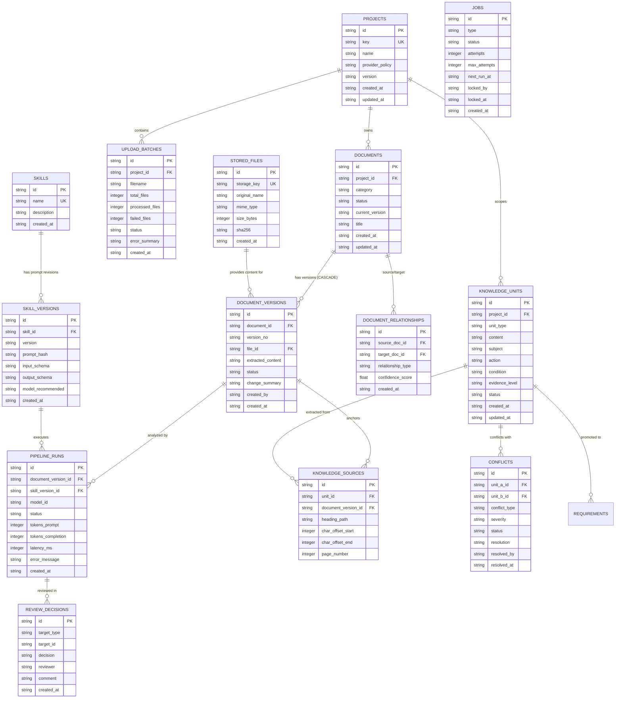

# Document Data Model & Knowledge Layer Specification

**Version:** 1.0.0-MVP  
**Status:** Approved by Tech Lead & BA  
**Ref Backlog:** `docs/BACKLOG-AI-DOCUMENT-PIPELINE.md` (Task E1-T2)  
**Storage Architecture:** SQLite WAL Mode + Structured FileStore (`server/data/files/`)

---

## 1. Mục tiêu & Nguyên tắc Thiết kế (Design Principles)

1. **Source of Truth là File Gốc (Original File as Source of Truth)**:
   - Nội dung tài liệu không chỉ lưu dạng JSON blob mà lưu tệp gốc nguyên vẹn byte-for-byte trong `stored_files` qua module `FileStore`.
   - Mã băm SHA-256 được tính toán trực tiếp trên toàn bộ byte của file gốc để chống giả mạo và bảo đảm tính toàn vẹn kiểm toán.
2. **Phiên bản Hóa Quan hệ (Relational Document Versioning)**:
   - Mỗi tài liệu (`documents`) sở hữu nhiều phiên bản (`document_versions`).
   - Mỗi phiên bản liên kết chính xác với một file gốc (`stored_files`) và chứa văn bản trích xuất có cấu trúc (`extracted_content`).
3. **Truy vết Toàn vẹn cho AI (Full AI Traceability)**:
   - Mọi kết quả phân tích AI đều truy ngược được về đúng `document_version_id`, `skill_version_id`, `model_id` và lưu vết token, latency trong `pipeline_runs`.
4. **Kiến trúc Tri thức Nguyên tử (Atomic Knowledge Layer)**:
   - Tri thức phân rã thành các đơn vị nguyên tử (`knowledge_units`) kèm vị trí neo chính xác (`knowledge_sources`: heading path, char offset, page).
   - Phân định rõ ràng giữa `evidence_level` (Explicit / Inferred / Assumed...) và `status` xét duyệt (Draft / In_Review / Approved / Superseded).
5. **Quyết định con người là tối cao (Human-in-the-Loop Governance)**:
   - Điểm số rủi ro hay AI chỉ dùng để xếp hàng đợi duyệt. Mọi trạng thái `Approved` đều ghi vết qua `review_decisions`.

---

## 2. Biểu đồ Quan hệ Thực thể (Mermaid ERD)

---

## 3. Danh mục Chi tiết Thực thể & Trường dữ liệu

### 3.1. Nhóm Quản lý Tệp & Phiên bản Tài liệu (Storage & Document Lifecycle)

#### 1. Bảng `stored_files`
- **Mục đích**: Quản lý các file gốc được lưu trữ trên đĩa (`server/data/files/`).
- **Owner**: Module Storage / FileStore.
- **Cấu trúc trường**:
  | Tên cột | Kiểu | Ràng buộc | Mô tả |
  |---|---|---|---|
  | `id` | `TEXT` | `PRIMARY KEY` | Mã định danh dạng UUID hoặc `FILE-<hash10>` |
  | `storage_key` | `TEXT` | `UNIQUE NOT NULL` | Đường dẫn tương đối trong FileStore (vd: `2026/11/PRJ-01/abc.md`) |
  | `original_name` | `TEXT` | `NOT NULL` | Tên tệp gốc do người dùng tải lên |
  | `mime_type` | `TEXT` | `NOT NULL` | MIME type được phát hiện (vd: `text/markdown`, `application/pdf`) |
  | `size_bytes` | `INTEGER`| `NOT NULL` | Kích thước byte thực tế |
  | `sha256` | `TEXT` | `NOT NULL` | Mã băm SHA-256 tính trực tiếp từ toàn bộ nội dung file gốc |
  | `created_at` | `TEXT` | `NOT NULL` | Thời điểm tải lên |

#### 2. Bảng `document_versions`
- **Mục đích**: Quản lý từng phiên bản độc lập của một tài liệu.
- **Owner**: Module Documents.
- **Cascade Delete**: Khi xóa `documents`, toàn bộ phiên bản thuộc tài liệu tự động bị xóa (`ON DELETE CASCADE`).
- **Cấu trúc trường**:
  | Tên cột | Kiểu | Ràng buộc | Mô tả |
  |---|---|---|---|
  | `id` | `TEXT` | `PRIMARY KEY` | Dạng `DOC-01-V1.0` |
  | `document_id` | `TEXT` | `NOT NULL, FK -> documents(id)` | Khóa ngoại trỏ đến tài liệu cha |
  | `version_no` | `TEXT` | `NOT NULL` | Số hiệu phiên bản (vd: `v1.0`, `v1.1`, `v2.0`) |
  | `file_id` | `TEXT` | `FK -> stored_files(id)` | Trỏ đến file vật lý nguồn |
  | `extracted_content` | `TEXT` | `NULLABLE` | Nội dung văn bản Markdown hoặc text trích xuất từ file |
  | `status` | `TEXT` | `NOT NULL` | `Draft`, `In Review`, `Approved`, `Rejected`, `Superseded` |
  | `change_summary` | `TEXT` | `NULLABLE` | Tóm tắt thay đổi so với bản trước |
  | `created_by` | `TEXT` | `NOT NULL` | Tác giả tải lên / chỉnh sửa |
  | `created_at` | `TEXT` | `NOT NULL` | Thời điểm tạo |

#### 3. Bảng `document_relationships`
- **Mục đích**: Lưu quan hệ liên tài liệu được phát hiện bởi hệ thống hoặc chỉ định thủ công.
- **Cấu trúc trường**:
  | Tên cột | Kiểu | Ràng buộc | Mô tả |
  |---|---|---|---|
  | `id` | `TEXT` | `PRIMARY KEY` | Dạng UUID |
  | `source_doc_id` | `TEXT` | `NOT NULL, FK -> documents(id)` | Tài liệu nguồn |
  | `target_doc_id` | `TEXT` | `NOT NULL, FK -> documents(id)` | Tài liệu đích |
  | `relationship_type` | `TEXT` | `NOT NULL` | `duplicate_of`, `version_of`, `references`, `supersedes` |
  | `confidence_score` | `REAL` | `NOT NULL DEFAULT 1.0` | Độ tin cậy (0.0 - 1.0) |
  | `created_at` | `TEXT` | `NOT NULL` | Thời điểm ghi nhận |

---

### 3.2. Nhóm Truy vết & Hợp đồng Kỹ năng AI (AI Traceability & Skill Contracts)

#### 4. Bảng `skills` & `skill_versions`
- **Mục đích**: Quản lý và bảo đảm tính bất biến của các prompt, schema và hợp đồng kỹ năng AI.
- **Cấu trúc trường `skills`**: `id`, `name`, `description`, `created_at`.
- **Cấu trúc trường `skill_versions`**:
  | Tên cột | Kiểu | Ràng buộc | Mô tả |
  |---|---|---|---|
  | `id` | `TEXT` | `PRIMARY KEY` | Dạng `<skill_id>@<version>` (vd: `intake@1.0.0`) |
  | `skill_id` | `TEXT` | `NOT NULL, FK -> skills(id)` | Khóa ngoại |
  | `version` | `TEXT` | `NOT NULL` | SemVer (vd: `1.0.0`, `1.1.0`) |
  | `prompt_hash` | `TEXT` | `NOT NULL` | SHA-256 của chuỗi prompt template |
  | `input_schema` | `TEXT` | `NOT NULL` | JSON Schema đầu vào |
  | `output_schema` | `TEXT` | `NOT NULL` | JSON Schema đầu ra |
  | `model_recommended` | `TEXT` | `NULLABLE` | Khuyến nghị model (vd: `gemini-3.8-flash`) |
  | `created_at` | `TEXT` | `NOT NULL` | Thời điểm công bố |

#### 5. Bảng `pipeline_runs`
- **Mục đích**: Ghi vết nhật ký thực thi chi tiết của từng bước AI Pipeline.
- **Cấu trúc trường**:
  | Tên cột | Kiểu | Ràng buộc | Mô tả |
  |---|---|---|---|
  | `id` | `TEXT` | `PRIMARY KEY` | Dạng `RUN-<timestamp>-<uuid>` |
  | `document_version_id` | `TEXT` | `NOT NULL, FK -> document_versions(id)` | Tài liệu xử lý |
  | `skill_version_id` | `TEXT` | `NOT NULL, FK -> skill_versions(id)` | Kỹ năng được gọi |
  | `model_id` | `TEXT` | `NOT NULL` | Model thực tế đã sinh output |
  | `provider` | `TEXT` | `NOT NULL` | `google`, `anthropic`, `openai`, `ollama` |
  | `status` | `TEXT` | `NOT NULL` | `PENDING`, `RUNNING`, `SUCCESS`, `FAILED` |
  | `input_payload` | `TEXT` | `NULLABLE` | Payload gửi đi (đã qua kiểm tra chính sách bảo mật) |
  | `output_payload` | `TEXT` | `NULLABLE` | JSON kết quả trả về từ model |
  | `tokens_prompt` | `INTEGER`| `DEFAULT 0` | Số token đầu vào |
  | `tokens_completion` | `INTEGER`| `DEFAULT 0` | Số token sinh ra |
  | `latency_ms` | `INTEGER`| `DEFAULT 0` | Thời gian phản hồi tính bằng mili-giây |
  | `error_message` | `TEXT` | `NULLABLE` | Lỗi nếu có |
  | `created_at` | `TEXT` | `NOT NULL` | Thời điểm chạy |

#### 6. Bảng `review_decisions`
- **Mục đích**: Lưu trữ phán quyết của người kiểm duyệt (Human-in-the-loop).
- **Cấu trúc trường**:
  | Tên cột | Kiểu | Ràng buộc | Mô tả |
  |---|---|---|---|
  | `id` | `TEXT` | `PRIMARY KEY` | Dạng `DEC-<uuid>` |
  | `target_type` | `TEXT` | `NOT NULL` | `document_version`, `knowledge_unit`, `conflict` |
  | `target_id` | `TEXT` | `NOT NULL` | Khóa định danh của đối tượng được duyệt |
  | `decision` | `TEXT` | `NOT NULL` | `Approve`, `Reject`, `Request_Changes` |
  | `reviewer` | `TEXT` | `NOT NULL` | Tên / Email người duyệt |
  | `comment` | `TEXT` | `NULLABLE` | Ghi chú phản hồi (bắt buộc khi Reject) |
  | `created_at` | `TEXT` | `NOT NULL` | Thời điểm đưa ra quyết định |

---

### 3.3. Nhóm Tầng Tri thức & Xử lý Xung đột (Knowledge Governance & Conflict Resolution)

#### 7. Bảng `knowledge_units`
- **Mục đích**: Chứa các đơn vị tri thức nghiệp vụ nguyên tử được trích xuất từ tài liệu.
- **Cấu trúc trường**:
  | Tên cột | Kiểu | Ràng buộc | Mô tả |
  |---|---|---|---|
  | `id` | `TEXT` | `PRIMARY KEY` | Dạng `KU-<uuid>` |
  | `project_id` | `TEXT` | `NOT NULL, FK -> projects(id)` | Dự án trực thuộc |
  | `unit_type` | `TEXT` | `NOT NULL` | `BusinessRule`, `RequirementCandidate`, `Constraint`, `TermDefinition` |
  | `content` | `TEXT` | `NOT NULL` | Nội dung mô tả ngắn gọn, súc tích |
  | `subject` | `TEXT` | `NULLABLE` | Chủ thể hành động (vd: `User`, `System`, `Approver`) |
  | `action` | `TEXT` | `NULLABLE` | Hành vi thực hiện (vd: `calculate_hash`, `verify_jwt`) |
  | `condition` | `TEXT` | `NULLABLE` | Điều kiện kích hoạt |
  | `evidence_level` | `TEXT` | `NOT NULL` | `Explicit`, `Inferred`, `Assumed`, `Not_Specified`, `Conflict`, `Unknown` |
  | `status` | `TEXT` | `NOT NULL` | `Draft`, `In_Review`, `Approved`, `Rejected`, `Superseded` |
  | `created_at` | `TEXT` | `NOT NULL` | Thời điểm tạo |
  | `updated_at` | `TEXT` | `NOT NULL` | Thời điểm cập nhật |

#### 8. Bảng `knowledge_sources`
- **Mục đích**: Neo chính xác vị trí trong văn bản gốc làm bằng chứng trích xuất cho `knowledge_units`.
- **Cấu trúc trường**:
  | Tên cột | Kiểu | Ràng buộc | Mô tả |
  |---|---|---|---|
  | `id` | `TEXT` | `PRIMARY KEY` | Dạng UUID |
  | `unit_id` | `TEXT` | `NOT NULL, FK -> knowledge_units(id) ON DELETE CASCADE` | Đơn vị tri thức |
  | `document_version_id` | `TEXT` | `NOT NULL, FK -> document_versions(id) ON DELETE CASCADE` | Phiên bản văn bản |
  | `heading_path` | `TEXT` | `NULLABLE` | Đường dẫn tiêu đề (vd: `1. Mục tiêu > 1.2 Phạm vi`) |
  | `char_offset_start` | `INTEGER`| `DEFAULT 0` | Vị trí ký tự bắt đầu |
  | `char_offset_end` | `INTEGER`| `DEFAULT 0` | Vị trí ký tự kết thúc |
  | `page_number` | `INTEGER`| `NULLABLE` | Trang tài liệu (đối với PDF) |

#### 9. Bảng `conflicts`
- **Mục đích**: Ghi nhận các xung đột mâu thuẫn giữa 2 đơn vị tri thức.
- **Cấu trúc trường**:
  | Tên cột | Kiểu | Ràng buộc | Mô tả |
  |---|---|---|---|
  | `id` | `TEXT` | `PRIMARY KEY` | Dạng `CONF-<uuid>` |
  | `unit_a_id` | `TEXT` | `NOT NULL, FK -> knowledge_units(id)` | Đơn vị tri thức A |
  | `unit_b_id` | `TEXT` | `NOT NULL, FK -> knowledge_units(id)` | Đơn vị tri thức B |
  | `conflict_type` | `TEXT` | `NOT NULL` | `DirectContradiction`, `Ambiguity`, `ScopeOverlap` |
  | `severity` | `TEXT` | `NOT NULL` | `Critical`, `Major`, `Minor` |
  | `status` | `TEXT` | `NOT NULL` | `Open`, `Resolved`, `Ignored` |
  | `resolution` | `TEXT` | `NULLABLE` | `Supersede_A`, `Supersede_B`, `Coexist`, `Rejected_Both` |
  | `resolved_by` | `TEXT` | `NULLABLE` | Người giải quyết |
  | `resolved_at` | `TEXT` | `NULLABLE` | Thời điểm giải quyết |

---

### 3.4. Nhóm Hàng đợi & Điều phối Xử lý Tệp (Job Queue & Upload Batches)

#### 10. Bảng `upload_batches`
- **Mục đích**: Theo dõi tiến trình tải lên hàng loạt hoặc trích xuất từ file nén ZIP.
- **Cấu trúc trường**:
  | Tên cột | Kiểu | Ràng buộc | Mô tả |
  |---|---|---|---|
  | `id` | `TEXT` | `PRIMARY KEY` | Dạng `BATCH-<uuid>` |
  | `project_id` | `TEXT` | `NOT NULL, FK -> projects(id)` | Dự án đích |
  | `filename` | `TEXT` | `NOT NULL` | Tên tệp nén hoặc gói tải lên |
  | `total_files` | `INTEGER`| `NOT NULL DEFAULT 0` | Tổng số file trong batch |
  | `processed_files` | `INTEGER`| `NOT NULL DEFAULT 0` | Số file đã xử lý thành công |
  | `failed_files` | `INTEGER`| `NOT NULL DEFAULT 0` | Số file bị lỗi |
  | `status` | `TEXT` | `NOT NULL` | `PENDING`, `PROCESSING`, `COMPLETED`, `PARTIAL`, `FAILED` |
  | `error_summary` | `TEXT` | `NULLABLE` | Tóm tắt các lỗi gặp phải |
  | `created_at` | `TEXT` | `NOT NULL` | Thời điểm tạo |

#### 11. Bảng `jobs`
- **Mục đích**: Hàng đợi công việc nền bền bỉ chạy trên SQLite, chống mất dữ liệu khi restart.
- **Cấu trúc trường**:
  | Tên cột | Kiểu | Ràng buộc | Mô tả |
  |---|---|---|---|
  | `id` | `TEXT` | `PRIMARY KEY` | Dạng `JOB-<uuid>` |
  | `type` | `TEXT` | `NOT NULL` | `EXTRACT_FILE`, `PIPELINE_RUN`, `PROMOTE_KNOWLEDGE`, `REINDEX_FTS` |
  | `payload` | `TEXT` | `NOT NULL` | JSON chứa thông tin tham số chạy job |
  | `status` | `TEXT` | `NOT NULL` | `PENDING`, `RUNNING`, `COMPLETED`, `FAILED`, `CANCELLED` |
  | `attempts` | `INTEGER`| `NOT NULL DEFAULT 0` | Số lần đã thử |
  | `max_attempts` | `INTEGER`| `NOT NULL DEFAULT 3` | Số lần thử tối đa |
  | `next_run_at` | `TEXT` | `NOT NULL` | Thời gian chạy tiếp theo (hỗ trợ exponential backoff) |
  | `locked_by` | `TEXT` | `NULLABLE` | Định danh worker đang xử lý (tránh chạy trùng) |
  | `locked_at` | `TEXT` | `NULLABLE` | Thời điểm lock |
  | `error` | `TEXT` | `NULLABLE` | Chi tiết lỗi lần chạy gần nhất |
  | `created_at` | `TEXT` | `NOT NULL` | Thời điểm tạo |
  | `updated_at` | `TEXT` | `NOT NULL` | Thời điểm cập nhật cuối |

---

## 4. Chính sách Xóa Cascade & Khóa Toàn vẹn (Integrity & Cascade Rules)

1. `PRAGMA foreign_keys = ON;` được kích hoạt ở mọi kết nối SQLite.
2. Xóa `projects`:
   - Xóa `documents`, `stored_files`, `knowledge_units`, `upload_batches` tương ứng.
   - Ghi audit event `DELETED_PROJECT` với mã băm kiểm toán bất biến.
3. Xóa `documents`:
   - Kích hoạt `CASCADE DELETE` cho toàn bộ `document_versions` của tài liệu đó.
   - Bảng `stored_files` được giữ lại nếu còn phiên bản khác tham chiếu, hoặc được thu hồi qua tác vụ dọn dẹp (Retention & Garbage Collection).
4. Xóa `knowledge_units`:
   - Xóa `knowledge_sources` tương ứng (`CASCADE`).
   - Xóa các bản ghi `conflicts` có liên quan.
