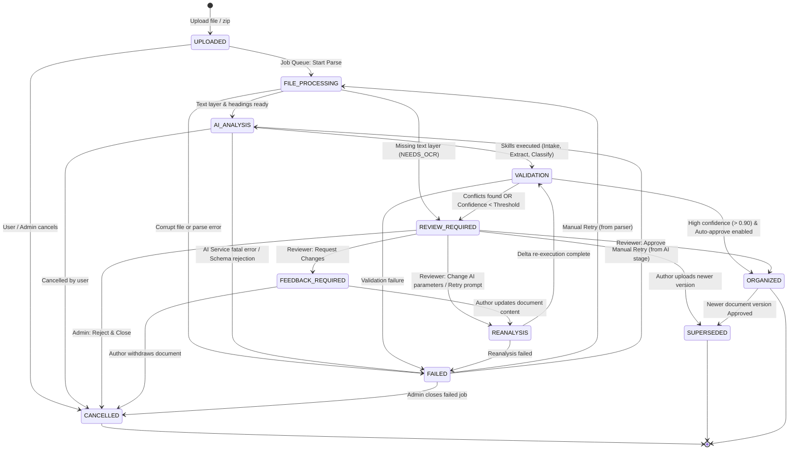

# Workflow State Machine Specification (AI Document Pipeline)

Tài liệu này quy định chi tiết máy trạng thái hữu hạn (**Finite State Machine - FSM**) điều phối toàn bộ vòng đời xử lý tài liệu, công việc chạy nền (**Job Queue**) và các cổng kiểm duyệt (**Human-in-the-loop Gates**) của nền tảng QA & Quản lý Tài liệu Dự án.

---

## 1. Danh sách 11 Trạng thái Vòng đời (Document Pipeline States)

```
+---------------+     +------------------+     +---------------+
|   UPLOADED    | --> | FILE_PROCESSING  | --> |  AI_ANALYSIS  |
+---------------+     +------------------+     +---------------+
                                                       |
                                                       v
+---------------+     +------------------+     +---------------+
|   ORGANIZED   | <-- | REVIEW_REQUIRED  | <-- |  VALIDATION   |
+---------------+     +------------------+     +---------------+
        |                       |                      |
        | (New version)         v (Changes needed)     | (Error)
        v                       v                      v
+---------------+     +------------------+     +---------------+
|  SUPERSEDED   |     |FEEDBACK_REQUIRED |     |    FAILED     |
+---------------+     +------------------+     +---------------+
```

| Mã trạng thái | Tên tiếng Việt | Bản chất | Mô tả |
|---|---|---|---|
| `UPLOADED` | Đã tải lên | Trạng thái bắt đầu | Tệp đã được upload thành công vào hệ thống, vượt qua kiểm tra bảo mật (E2-T1) và lưu vào `FileStore` & `stored_files`. |
| `FILE_PROCESSING` | Đang xử lý tệp | Tiến trình nền | Hệ thống đang phân tích định dạng (.md, .txt, .docx, .pdf), trích xuất văn bản, bảng biểu, danh sách heading kèm character offsets. |
| `AI_ANALYSIS` | Phân tích AI | Tiến trình nền | AI Skill Pipeline (Intake, Understanding, Extraction, Classification) đang phân tích tài liệu để bóc tách tri thức và phân loại thư mục. |
| `VALIDATION` | Kiểm tra ngữ nghĩa | Tiến trình nền | Đối soát mâu thuẫn ngữ nghĩa (Semantic Validation) với tri thức đã duyệt của dự án, tính điểm tin cậy và phân loại rủi ro. |
| `REVIEW_REQUIRED` | Chờ người duyệt | Cổng kiểm duyệt | Tài liệu có độ tin cậy chưa đạt tuyệt đối, có mâu thuẫn logic hoặc chứa quy tắc nghiệp vụ quan trọng cần con người ký duyệt. |
| `ORGANIZED` | Đã tổ chức xong | Trạng thái hoàn tất | Toàn bộ tri thức, yêu cầu và quy tắc đã được phê duyệt, lưu vào Knowledge Graph và Traceability Matrix. |
| `FEEDBACK_REQUIRED` | Cần phản hồi | Cổng trao đổi | Người duyệt yêu cầu tác giả/BA làm rõ hoặc chỉnh sửa tài liệu gốc trước khi phê duyệt tiếp. |
| `REANALYSIS` | Đang tái phân tích | Tiến trình nền | Xử lý lại một phần hoặc toàn bộ tài liệu sau khi nhận phản hồi hoặc cập nhật điều chỉnh từ người duyệt. |
| `FAILED` | Thất bại | Trạng thái lỗi | Gặp sự cố không thể khắc phục (tệp hỏng nặng, lỗi phần cứng, hết số lần retry). Cho phép retry thủ công. |
| `CANCELLED` | Đã hủy bỏ | Trạng thái dừng | Tiến trình bị hủy bởi Admin hoặc người sở hữu tài liệu khi đang chờ hoặc đang chạy. |
| `SUPERSEDED` | Đã bị thay thế | Trạng thái lịch sử | Phiên bản tài liệu cũ đã được thay thế bởi phiên bản mới (`v2.0`, `v1.1`...). Vẫn lưu để đối chiếu lịch sử. |

---

## 2. Biểu đồ Chuyển Trạng thái (Mermaid State Diagram)



---

## 3. Ma trận Phân quyền & Điều kiện Chuyển Trạng thái (Transition Matrix)

| Trạng thái hiện tại | Trạng thái đích | Sự kiện / Trigger | Điều kiện tiên quyết (Pre-conditions) | Role được phép | Hành động phụ (Side Effects) |
|---|---|---|---|---|---|
| `UPLOADED` | `FILE_PROCESSING` | `JOB_DISPATCHED` | Job trích xuất tệp được worker nhận và gán khóa `locked_by`. | `System Worker` | Ghi audit `JOB_STARTED`. |
| `UPLOADED` | `CANCELLED` | `CANCEL_UPLOAD` | Người dùng chủ động hủy tệp trước khi xử lý. | `Document Author`, `Project Admin` | Đánh dấu job `CANCELLED`. |
| `FILE_PROCESSING` | `AI_ANALYSIS` | `PARSE_SUCCESS` | Parser trích xuất thành công văn bản, có text layer (`hasTextLayer: true`). | `System Worker` | Lưu `extractedContent` vào `document_versions`. |
| `FILE_PROCESSING` | `REVIEW_REQUIRED` | `PARSE_NEEDS_OCR` | PDF dạng ảnh quét không có text layer (`warnings: ['NEEDS_OCR']`). | `System Worker` | Gắn nhãn `NEEDS_OCR`, dừng gọi AI tốn chi phí. |
| `FILE_PROCESSING` | `FAILED` | `PARSE_ERROR` | Tệp hỏng, parser ném ngoại lệ không xử lý được. | `System Worker` | Ghi `errorSummary`, cập nhật job `FAILED`. |
| `AI_ANALYSIS` | `VALIDATION` | `SKILLS_SUCCESS` | Hoàn thành trích xuất dữ liệu, JSON schema hợp lệ. | `System Worker` | Ghi bản ghi vào `pipeline_runs`. |
| `AI_ANALYSIS` | `FAILED` | `AI_ERROR` | Lỗi API provider, vượt quota, hoặc retry schema quá số lần quy định. | `System Worker` | Ghi log token và error message vào `pipeline_runs`. |
| `VALIDATION` | `ORGANIZED` | `AUTO_APPROVE` | Điểm tin cậy $\ge 0.90$, 0 xung đột nghiệp vụ, dự án bật tự động duyệt. | `System Worker` | Tạo `KnowledgeUnits`, gán trạng thái `Approved`. |
| `VALIDATION` | `REVIEW_REQUIRED` | `NEEDS_HUMAN` | Điểm tin cậy $< 0.90$, hoặc phát hiện mâu thuẫn (Conflict), hoặc quy tắc trọng yếu. | `System Worker` | Tạo thông báo review cho Reviewer/PM. |
| `REVIEW_REQUIRED` | `ORGANIZED` | `MANUAL_APPROVE` | Reviewer duyệt các đề xuất phân loại và tri thức bóc tách. | `Reviewer / Approver`, `Project Admin` | Ghi `review_decisions`, chuyển Knowledge sang `Approved`. |
| `REVIEW_REQUIRED` | `FEEDBACK_REQUIRED` | `REQUEST_CHANGES` | Reviewer phát hiện nội dung tài liệu gốc sai sót, cần tác giả sửa. | `Reviewer / Approver`, `Project Admin` | Ghi `review_decisions` (`Request_Changes`), thông báo tác giả. |
| `REVIEW_REQUIRED` | `REANALYSIS` | `PROMPT_RETRY` | Reviewer đổi Document Type hoặc tinh chỉnh hướng dẫn AI. | `Reviewer / Approver`, `Project Admin` | Chỉ chạy lại Skill liên quan (không chạy lại Understanding). |
| `REVIEW_REQUIRED` | `SUPERSEDED` | `NEW_VERSION_UPLOAD` | Tác giả tải lên phiên bản tài liệu mới thay thế phiên bản đang review. | `Document Author`, `Project Admin` | Chuyển bản cũ sang `SUPERSEDED`, bắt đầu pipeline cho bản mới. |
| `FEEDBACK_REQUIRED` | `REANALYSIS` | `AUTHOR_REVISED` | Tác giả tải lên nội dung bổ sung hoặc sửa đổi. | `Document Author`, `Project Admin` | Ghi audit `REVISION_SUBMITTED`, chạy lại Validation/AI. |
| `ORGANIZED` | `SUPERSEDED` | `NEW_DOC_APPROVED` | Phiên bản kế tiếp của tài liệu đạt trạng thái `ORGANIZED`. | `System Worker`, `Reviewer / Approver` | Chuyển các Knowledge Unit phiên bản cũ sang `Superseded`. |
| `FAILED` | `FILE_PROCESSING` / `AI_ANALYSIS` | `MANUAL_RETRY` | Quản trị viên kích hoạt Retry job từ stage bị lỗi. | `Project Admin` | Đặt lại attempts = 0, next_run_at = NOW. |

---

## 4. Nguyên tắc Idempotency & Tối ưu Chi phí AI (Granular Stage Retries)

1. **Cô lập giai đoạn (Stage Isolation)**:
   - Khi người duyệt **chỉ sửa Document Type / Thư mục** (Classification):
     * **KHÔNG** chạy lại giai đoạn Intake hay Understanding.
     * Chỉ cập nhật thuộc tính `category` và xác minh lại liên kết tổ chức (`Organization`).
   - Khi người duyệt **chỉ từ chối 1 quy tắc (Atomic Unit)** trong 20 quy tắc:
     * Quy tắc đó chuyển trạng thái `Rejected`.
     * 19 quy tắc còn lại vẫn giữ nguyên trạng thái `Approved`.
     * Tài liệu chuyển sang `ORGANIZED` với ghi chú loại trừ.

2. **Chính sách Phiên bản Gối đầu (Superseding Policy)**:
   - Khi tài liệu `DOC-01` phiên bản `v1.0` đang ở trạng thái `REVIEW_REQUIRED` hoặc `FEEDBACK_REQUIRED`, nếu người dùng tải lên bản `v1.1`:
     * Bản `v1.0` lập tức được đánh dấu `SUPERSEDED`.
     * Toàn bộ review pending của `v1.0` được đóng lại với lý do `"Replaced by v1.1"`.
     * Bản `v1.1` bắt đầu pipeline mới từ `UPLOADED`.

3. **Bảo toàn Audit Trail**:
   - Mọi lần chuyển đổi trạng thái bắt buộc phải sinh ra một bản ghi `AuditEvent` được băm xích mã hóa SHA-256 (`computeAuditEventHash`).
   - Audit lưu rõ `actor`, `sourceState`, `targetState`, `reason`, và `timestamp`.
